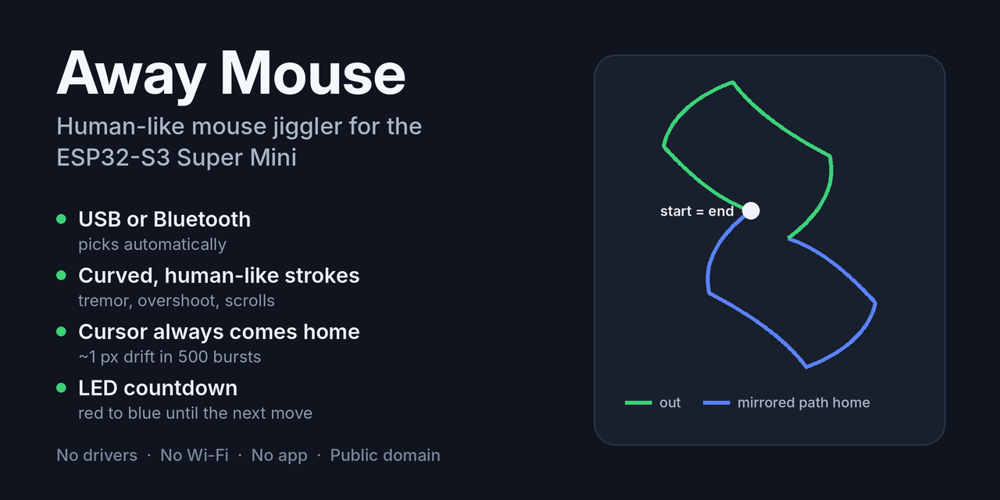

# Away Mouse: ESP32-S3 USB + Bluetooth Mouse Jiggler

Firmware that turns a few-dollar **ESP32-S3 Super Mini** into a hardware **mouse jiggler** (mouse mover) that moves like a person. It keeps a computer awake and stops the screen from locking or going idle, with no software on the computer. Plug it into a USB port and it's a USB mouse. Power it from a charger instead and it's a Bluetooth mouse. Either way, it starts moving the cursor a few seconds after a computer connects.

Flash the prebuilt `.bin` from your browser; no Arduino IDE needed.

- Curved strokes with a slow-fast-slow speed profile, a little hand tremor, occasional overshoot-and-correct, pauses, and the odd scroll
- Every burst returns the cursor to exactly where it started, so it never creeps toward the edge of the screen
- No clicks, no keypresses, no drivers. The computer sees an ordinary mouse.
- The onboard RGB LED shows when it's moving and counts down to the next burst
- No Wi-Fi, no app, no buttons. Power it and it runs.

Tested over USB and Bluetooth on Windows and Android.

## How it's different

Most hardware jigglers nudge the cursor a few pixels on a timer, over USB only. Away Mouse is built to look like a hand on a mouse:

| | Typical hardware jiggler | Away Mouse |
|---|---|---|
| Connection | USB *or* Bluetooth | **Both**, chosen automatically |
| Movement | Small, regular nudges | Curved strokes, varied speed, tremor, overshoot, scrolls |
| Timing | Fixed interval | Randomized bursts and pauses |
| Cursor position | Back-and-forth in place, or drifts | Mirrored return path, ~1 px drift over 500 bursts |
| Status | None or a blinking light | LED countdown to the next move |
| Setup | Varies | Browser flash, nothing to install, no Wi-Fi |

## Hardware

- ESP32-S3 Super Mini (4MB flash). Any ESP32-S3 board with native USB should work; you may need to change `LED_PIN` and `LED_COLOR_ORDER` in `config.h`.
- A USB-C cable. For Bluetooth mode, also a USB charger or power bank.

## Flashing

Download `AwayMouse-S3-SuperMini-factory.bin` from the [latest release](../../releases/latest). It's a complete image (bootloader, partition table and app), so it goes at offset **0x0**.

1. Hold **BOOT**, plug the board into your computer, then release BOOT.
2. Open a browser-based flasher in Chrome or Edge, such as [ESP Tool](https://espressif.github.io/esptool-js/) or [ESPHome Web](https://web.esphome.io/).
3. Connect, choose the .bin, set the address to `0x0`, and flash. Erasing first is a good idea if the board had other firmware on it.
4. Unplug it and plug it back in. The computer finds a new mouse and the cursor starts moving a few seconds later.

After this, the USB port is only a mouse and no longer a serial port. To reflash, use the BOOT-button method again.

## LED

| Color | Meaning |
|---|---|
| Green | Moving the cursor |
| Red → purple → blue | Waiting. Red right after a burst, fading to blue just before the next one |
| Off | No computer connected (or Bluetooth still pairing) |

The fade is timed to each wait, so purple means the next burst is about halfway there, whether the pause is 10 seconds or 45.

## Bluetooth

Power the board from a USB charger. After about 3 seconds with no computer on the USB port, it starts advertising as **BT5.0 Mouse**. Pair it from your device's Bluetooth settings; there's no PIN.

- It remembers up to 3 paired devices and reconnects on its own after a power cycle.
- Flashing erases the pairings. If a device already knows "BT5.0 Mouse", remove it there and pair again.

## USB or Bluetooth?

At power-up it starts as a USB mouse. If a computer enumerates it, it stays on USB. If nothing does within 3 seconds, it switches on Bluetooth. A computer that enumerates it later still wins and Bluetooth disconnects, so this also works when the computer is still booting.

When the computer sleeps, the USB bus suspends and the mouse stops moving, so it won't wake the computer.

## How the cursor stays put

A mouse can't read the cursor position, so the motion is built to cancel itself out:

- Each burst records its outbound reports, waits a moment, then plays the same reports back negated, in the same order. The trip home is the outbound path rotated 180°, so it doesn't visibly retrace its steps.
- Every report has an equal-and-opposite partner with the same size and timing, so pointer acceleration (such as Windows "Enhance pointer precision") scales both the same way and they cancel. In simulation, 500 bursts with an acceleration curve drifted about 1 pixel.
- Scrolling is out-and-back too: a few notches down, a pause to "read", then the same number back up.

If the connection drops in the middle of a burst, that burst can leave the cursor slightly off.

## Tuning

Everything adjustable is in [`AwayMouse/config.h`](AwayMouse/config.h):

| Setting | Default | What it does |
|---|---|---|
| `PAUSE_MIN_S` / `PAUSE_MAX_S` | 10 / 45 | Seconds between bursts |
| `FIRST_MOVE_DELAY_MIN_MS` / `_MAX_MS` | 2000 / 5000 | Delay before the first burst after connecting |
| `MOVES_MIN` / `MOVES_MAX` | 2 / 5 | Strokes per burst |
| `WANDER_PX` | 150 | Max distance from the burst's starting point, in mouse counts |
| `SPEED` | 1.0 | 0.5 is slower, 2.0 is faster |
| `OVERSHOOT_CHANCE` | 0.30 | Chance a stroke overshoots and corrects |
| `TREMOR_PX` | 0.6 | Hand-tremor amplitude |
| `SCROLL_CHANCE` | 0.15 | Chance a burst includes a scroll |
| `SCROLL_NOTCHES_MIN` / `_MAX` | 1 / 4 | Scroll notches |
| `USB_DETECT_MS` | 3000 | How long to wait for USB before falling back to Bluetooth |
| `LED_BRIGHTNESS` | 24 | 0–255 |
| `LED_COLOR_ORDER` | RGB | The Super Mini's LED is RGB. Use `LED_COLOR_ORDER_GRB` for standard WS2812 LEDs (if green shows up red). |
| `USB_*`, `BLE_NAME` | | The names and IDs the computer sees |

`WANDER_PX` is in mouse counts. With pointer acceleration on, the cursor travels roughly twice that on screen.

## Building

Install the **esp32** board package (3.3.x) in the Arduino IDE, open `AwayMouse/AwayMouse.ino`, and use these settings:

| Setting | Value |
|---|---|
| Board | ESP32S3 Dev Module |
| USB Mode | USB-OTG (TinyUSB) |
| USB CDC On Boot | Disabled |
| Flash Size | 4MB |
| Partition Scheme | Huge APP (3MB No OTA/1MB SPIFFS) |
| Flash Mode | DIO 80MHz |
| PSRAM | Disabled |

**Sketch → Export Compiled Binary** produces `AwayMouse.ino.merged.bin`, which you flash at 0x0 the same way. Uploading straight from the IDE also works once the board is in download mode (hold BOOT while plugging it in).

The release binary was built with esp32 core 3.3.10.

A debug log goes out the UART TX pin (GPIO43) at 115200 baud, never over USB.

## Files

| File | What it is |
|---|---|
| `AwayMouse.ino` | Main loop: waits for a link, schedules bursts, drives the LED |
| `config.h` | All the tunable settings |
| `links.cpp` / `links.h` | USB HID mouse, Bluetooth LE HID mouse, and automatic switching |
| `motion.h` | The human-like, self-cancelling motion engine (no Arduino dependencies) |

## FAQ

**Does it need drivers or software on the computer?**
No. It's a standard HID mouse over USB and a standard HID-over-GATT mouse over Bluetooth.

**Does it work on macOS, Linux, iPad or ChromeOS?**
It's been tested on Windows and Android. It only uses the standard HID mouse profile, so other systems should work, but they haven't been tested. Reports are welcome.

**Will it click on anything or type?**
No. It only moves the cursor and scrolls the wheel. It never presses a button or key.

**Will it wake my computer from sleep?**
No. When the computer suspends the USB bus, the mouse stops moving until it wakes.

**Can I use a different ESP32 board?**
Any ESP32-S3 with native USB should work. The original ESP32 and the ESP32-C3 don't have native USB, so only Bluetooth mode could work on those, and this firmware isn't built for them.

## License

Released into the public domain under [CC0 1.0](LICENSE). Do whatever you like with it.

The prebuilt binary also contains the Arduino-ESP32 core (LGPL-2.1), ESP-IDF and NimBLE (Apache-2.0), and TinyUSB (MIT), under their own licenses.
